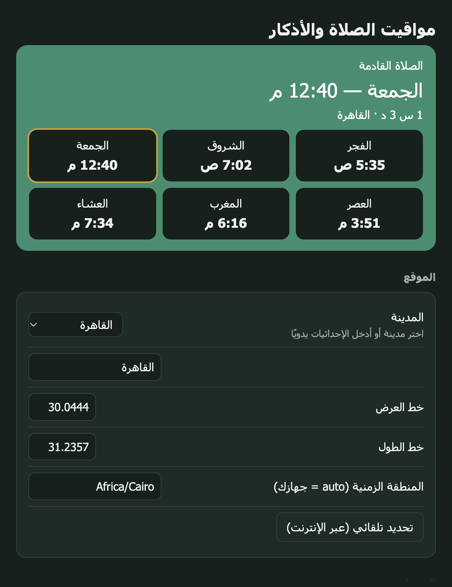
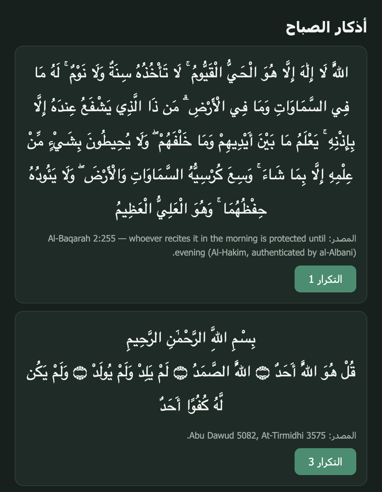

<div align="center">

# 🕌 Salah Reminder · مواقيت الصلاة والأذكار

Offline prayer times and adhkar reminders that live in your menu bar / system tray.<br>
مواقيت صلاة وتذكير بالأذكار يعمل بدون إنترنت من شريط القوائم / صينية النظام.

[English](#english) · [العربية](#العربية)

 

</div>

<!-- Replace with real screenshots from the packaged app on each OS (see CONTRIBUTING.md). -->
| Settings (Arabic) | Adhkar | Tray / menu bar |
| --- | --- | --- |
|  |  | _screenshot placeholder: `docs/screenshots/tray.png`_ |

---

## English

### Features
- **Offline calculation** with [adhan-js](https://github.com/batoulapps/adhan-js): Egyptian, Muslim World League, Umm al-Qura, Karachi, ISNA, Dubai, Kuwait, Qatar, Singapore, Turkey (Diyanet), Tehran, Moonsighting Committee; Shafi/Hanafi Asr; manual per-prayer minute adjustments; high-latitude handling.
- **Location:** pick from 40+ built-in cities, enter coordinates, or press *Detect* (the only network call, user-initiated, IP-based).
- **Notifications** before the adhan (configurable minutes) and at prayer time, with system sound, silent, or your own audio file.
- **Adhkar reminders:** morning (after Fajr), evening (after Asr) and after each prayer, with configurable delays. Click the notification to open a counter-based reader.
- **Tray / menu bar:** next prayer + countdown (shown next to the icon on macOS; tooltip + menu on Windows/Linux), full day's times in the menu. Friday shows *Jumu'ah*.
- **Launch at login**, Arabic (RTL) and English UI.

### Install
Download the installer for your OS from the [Releases](../../releases) page (`.dmg` macOS, `.exe` Windows, `.AppImage`/`.deb` Linux).

> The builds are **not code-signed yet**. macOS: right-click the app → *Open* the first time (or `xattr -cr "/Applications/Salah Reminder.app"`). Windows: *More info → Run anyway* in SmartScreen.

### Run from source
```bash
npm install
npm start          # tray app (opens Settings on first run)
npm test           # unit tests
npm run dist       # package for the current OS into dist/
```

### Releasing
Push a tag (`git tag v0.1.0 && git push --tags`). GitHub Actions builds macOS, Windows and Linux packages and attaches them to a GitHub Release.

### Adhkar sources
The text in [`data/adhkar.json`](data/adhkar.json) consists of Quran verses and hadith wording from the six canonical collections (Sahih al-Bukhari, Sahih Muslim, Sunan Abi Dawud, Jami' at-Tirmidhi, Sunan an-Nasa'i, Ibn Majah), as compiled in *Hisn al-Muslim* (Sa'id ibn Wahf al-Qahtani). Quran text and hadith wording are not under copyright; this project's compilation is MIT-licensed. Each item carries its own reference. English meanings are our own paraphrase. **Please report any wording or reference error** by opening an issue — the list is intentionally small and conservative; contributions welcome (see [CONTRIBUTING](CONTRIBUTING.md)).

### Disclaimer
Calculated times can differ by a few minutes from your local mosque or official authority. Use the manual adjustment setting to match them.

### Credits
[adhan-js](https://github.com/batoulapps/adhan-js) (MIT) · [Electron](https://www.electronjs.org/) (MIT).

---

## العربية

### المميزات
- **حساب المواقيت بدون إنترنت** بمكتبة [adhan-js](https://github.com/batoulapps/adhan-js): الهيئة المصرية، رابطة العالم الإسلامي، أم القرى، كراتشي، أمريكا الشمالية، دبي، الكويت، قطر، سنغافورة، ديانت تركيا، طهران، لجنة رؤية الهلال، مع مذهب العصر (جمهور/حنفي) وتعديل يدوي بالدقائق لكل صلاة.
- **الموقع:** اختر من أكثر من ٤٠ مدينة، أو أدخل الإحداثيات، أو اضغط «تحديد تلقائي» (الاتصال الوحيد بالإنترنت، وبطلبك فقط).
- **تنبيهات** قبل الأذان (بعدد دقائق تضبطه) وعند دخول الوقت، بصوت النظام أو بدون صوت أو بملف صوتي من اختيارك.
- **تذكير بالأذكار:** الصباح (بعد الفجر)، المساء (بعد العصر)، وبعد كل صلاة، بتأخير قابل للضبط. اضغط على التنبيه لفتح قارئ بعدّاد للتكرار.
- **أيقونة الشريط/الصينية:** الصلاة القادمة والعد التنازلي (بجانب الأيقونة في macOS، وفي التلميح والقائمة على Windows/Linux)، ومواقيت اليوم كاملة في القائمة. يوم الجمعة يظهر «الجمعة».
- **تشغيل تلقائي** مع بدء النظام، وواجهة عربية (RTL) وإنجليزية.

### التثبيت
نزّل ملف التثبيت لنظامك من صفحة [Releases](../../releases) (`.dmg` للماك، `.exe` للويندوز، `.AppImage` أو `.deb` للينكس).

> النسخ **غير موقّعة رقميًا حاليًا**. على macOS: كليك يمين على التطبيق ← «فتح» أول مرة (أو `xattr -cr "/Applications/Salah Reminder.app"`). على Windows: «مزيد من المعلومات ← تشغيل على أي حال».

### التشغيل من الكود
```bash
npm install
npm start      # يفتح الإعدادات أول مرة
npm test       # الاختبارات
npm run dist   # بناء حزمة للنظام الحالي
```

### مصادر الأذكار
نصوص [`data/adhkar.json`](data/adhkar.json) هي آيات قرآنية وألفاظ أحاديث من الكتب الستة (صحيح البخاري، صحيح مسلم، سنن أبي داود، جامع الترمذي، سنن النسائي، سنن ابن ماجه) كما جُمعت في «حصن المسلم» للشيخ سعيد بن وهف القحطاني. نص القرآن وألفاظ الأحاديث غير خاضعة لحقوق النشر، وهذا التجميع مرخّص بـ MIT. كل ذكر معه مرجعه. المعاني الإنجليزية من صياغتنا. **القائمة مختصرة ومتحفظة عمدًا — من لاحظ خطأ في لفظ أو عزو فليفتح issue، والمساهمات مرحّب بها.**

### تنبيه
قد تختلف المواقيت المحسوبة بدقائق عن مسجدك أو الجهة الرسمية، استخدم التعديل اليدوي للمطابقة.

---

MIT © Ahmed Gamal
