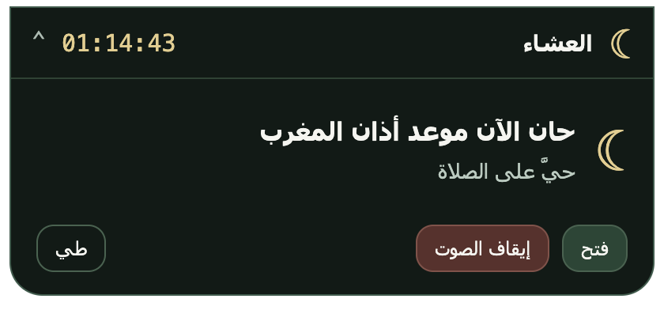

# Persistent notch bar — v0.1.2

Verified on macOS with the packaged application installed in `/Applications`.
The bar remains optional in Settings. Enabled it for the current installation as requested;
retained the existing location, calculation method, reminders and volume settings.

## Behavior

- Compact 300×54-point window below the notch/menu bar: next prayer and `HH:MM:SS` countdown.
- The counter updates once per second. Astronomical calculations are cached until the minute,
  settings or next-prayer boundary changes.
- Clicking the compact bar opens today's six times inside the same window. The next prayer is highlighted.
  Click again, Collapse or Escape to return to the compact bar.
- At the adhan the window expands with Stop sound and stays expanded while playback is active.
  Stop sound or the media's ended event returns it to the compact bar; the bar remains visible.
- Other notifications return to compact after 15 seconds. Manually collapsing while audio continues
  retains a compact Stop sound control.
- Preview while disabled is temporary. Disabling the feature hides it without interrupting audio.

## Checks performed

- 68 automated tests passed, including countdown formatting, persistent visibility,
  view transitions, preview/disable behavior, and holding an active adhan beyond 15 seconds.
- Native macOS UI: clicked the compact bar and observed all six times; clicked the expanded
  Stop sound button and observed the return to the compact bar.
- Captured successive countdown values one second apart from the installed application,
  with a visible 54-point-high compact window.
- Used the existing test clock to fire the next prayer without changing system time.
  The alert was still expanded, audio was playing and Stop sound was visible after more than 15 seconds.
  The next-prayer label had advanced to the following prayer.
- Sought the playing audio near its end in the test session; the actual HTML media ended event fired,
  and the window returned to compact while remaining visible.
- Relaunched without test clock/debugging flags, leaving the persistent bar active.
- Built and verified the packaged application's ad-hoc signature. Full-screen/multiple-monitor behavior
  and screen-reader usability have not been evaluated on this machine.

