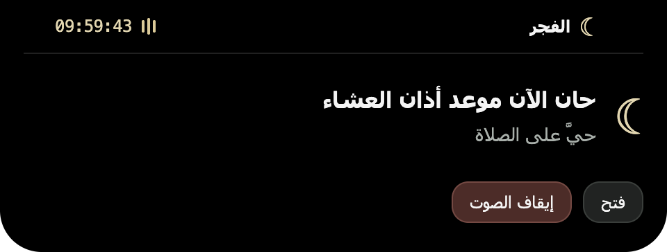

# Published macOS v0.1.4 verification — 2026-10-23

## Exact released artifact

Downloaded `Salah.Reminder-0.1.4-arm64-mac.zip` from the public v0.1.4 Release. The complete ZIP matched the GitHub asset digest:

`sha256:91aea6f23d7f41217c84e8c6b344c9cd220d6600b8be865e9abb8abf6b80ad23`

Installed that extracted application to `/Applications/Salah Reminder.app`. Bundle version: `0.1.4`. Installed and extracted `app.asar` both hashed to:

`7e000501f3b41f74fd882b46e4441704d10fcbdf4765905b09324a394b42eb3d`

`codesign --verify --deep --strict` passed for the existing **ad-hoc** signature. This is not a Developer ID signature or notarization, and CLI download did not exercise browser quarantine/Gatekeeper first-launch behavior.

## Normal display and native mouse

- The collapsed surface was **185 × 57.5 pt**: exactly the physical camera housing width, extended 24 pt below the camera to display the prayer name and countdown.
- Observed the visible prayer name and countdown while collapsed; countdown progressed from `00:14:50` to `00:14:47` without opening the panel.
- Native mouse drag positioning over the notch expanded today's six prayer rows. Moving the native pointer away returned to compact dimensions. This exercised the native cursor polling, not only a synthetic DOM mouse event.
- Verified the renderer's real packaged URL, rather than loading the source checkout.

## Scheduled adhan and stop/end behavior

Used the released application's existing `SALAH_E2E=1` hook: the app's clock jumps to four seconds before the next scheduled prayer, without changing the operating-system clock. Screen locking was configured `none` and was left unchanged.

- Log confirmed scheduled adhan event, native notification `show` delivery and media playback (duration **154.020862 s**, volume **0.8**).
- Panel stayed in `alert` mode with `playing=true` and Stop visible after 17 seconds, including attempts to dismiss/toggle during playback.
- Invoking the overlay Stop action cleared the audio element and returned the surface to compact, `playing=false`, Stop hidden.
- The user stopped playback during intermediate attempts; these are **not** counted as natural-completion results.
- Repeated with the test audio element muted locally (no system volume or saved preference change). It played beyond the 15-second reminder timeout with no media error. After 18 seconds, seeking to the final half-second produced the browser's genuine `ended` event, no `sound:stop` IPC, no media error, and automatic return to compact with Stop hidden. This verifies the end event handling, not a full real-time 154-second listen-through.
- No microphone/acoustic recording was made; playback/decoding and completion were observed through the packaged player.

## Restoration and limits

Saved settings were byte-identical before/after testing. Relaunched the released application with `--hidden`, no simulated clock and no remote-debugging flag. The existing release/tag was not replaced. No runtime changes were needed for these checks.

The checkout's 76 tests passed. The signing configuration and workflow YAML validate, but a credentialed signed/notarized build has not run. Mac App Store sandbox behavior, Windows/Linux runtime behavior, multi-monitor/full-screen transitions and store approval remain separate verification steps.
